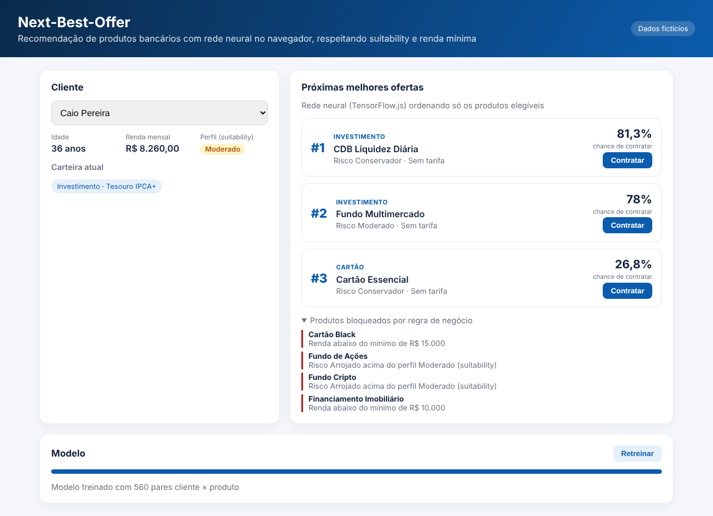
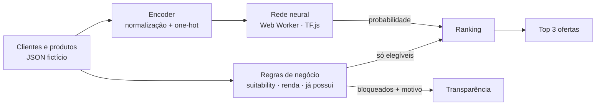
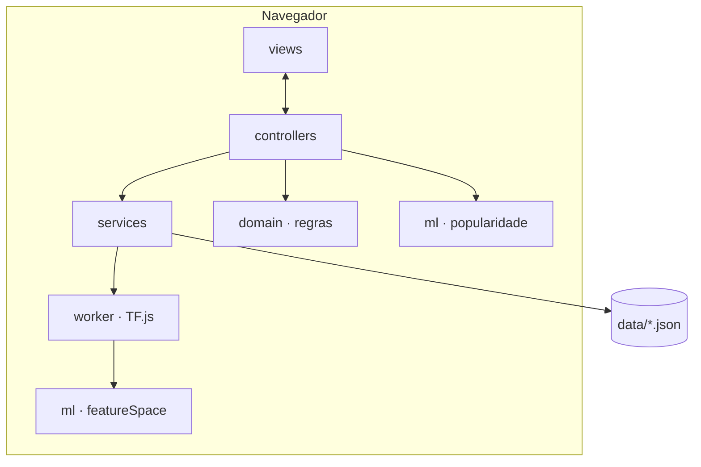

# 🏦 Next Best Offer - Recomendador bancário com IA

[](https://github.com/CesarioStoquero/next-best-offer/actions/workflows/ci.yml)


Recomenda o **próximo produto bancário** (cartão, investimento, seguro, crédito, previdência) para cada cliente com uma **rede neural treinada no próprio navegador**, e só oferece o que o cliente **pode** contratar: respeita **suitability** e **renda mínima**.



---

## 💼 O problema de negócio

- Bancos ganham com **venda cruzada (cross-sell)**, mas ofertas genéricas convertem pouco.
- Oferecer um produto **acima do perfil de risco** do cliente viola a regra de **suitability** e gera risco regulatório.
- Oferecer o que o cliente **não tem renda** para contratar só gera recusa e frustração.
- Cliente novo não tem histórico (**cold start**) e mesmo assim precisa de uma boa primeira oferta.

## ⚙️ Como funciona



1. **Regras primeiro:** cada produto passa por 3 regras (Specification). O que falha vai para a lista de bloqueados, com o motivo.
2. **Tudo vira número:** produto = categoria (one-hot) + risco + tarifa + idade média de quem tem; cliente = média da carteira + idade, renda e perfil.
3. **Treino:** pares `[cliente + produto] → já contratou? (1/0)`, numa rede `64 → 32 → 1 (sigmoid)`.
4. **Recomendação:** a rede dá a chance de contratar **só para os elegíveis**, e o app mostra o top 3.
5. **Cold start:** cliente sem produtos recebe os mais populares entre os elegíveis.

## 🧱 Arquitetura



| Pasta | Responsabilidade |
|---|---|
| `src/domain` | Regras de negócio puras: suitability, renda mínima, já possui (pattern Specification) |
| `src/ml` | Encoder de features, conjunto de treino e ranking por popularidade (funções puras) |
| `src/workers` | Treino e predição com TensorFlow.js fora da thread da tela |
| `src/services` | Acesso aos dados e cliente do Worker |
| `src/controllers` | Orquestram views, regras e modelo via eventos |
| `src/views` | Renderização da interface |
| `tests` | Testes unitários com `node:test` |

## 🧠 Decisões técnicas

| Decisão | Por quê |
|---|---|
| **Regra no domínio, ML só ordena** | Compliance não pode depender de um modelo estatístico: o modelo nunca vê um produto proibido |
| **Specification para elegibilidade** | Cada regra é isolada, testável e explica o próprio motivo de bloqueio |
| **Treino em Web Worker** | A interface não trava enquanto a rede aprende |
| **Sem backend** | Segue a arquitetura da referência: dados estáticos em JSON e IA 100% no cliente (nenhum dado sai do navegador) |
| **Encoder em funções puras** | O mesmo código roda no Worker e nos testes em Node |
| **Cold start por popularidade** | Sem histórico não há padrão para a rede aprender: a melhor aposta é o que mais gente contrata |

## 📊 Resultado

Avaliação **leave-one-out** (esconder 1 produto de cada cliente e verificar se ele volta no top 3), em 31 clientes com 2 ou mais produtos:

| Estratégia | Hit@3 |
|---|---|
| Ranking por popularidade | 35% |
| **Rede neural** | **45%** |

> Resultado de uma rodada; varia um pouco a cada treino. Dataset pequeno e fictício.

## ▶️ Rodando localmente

Pré-requisito: **Node.js 22+**

```bash
git clone https://github.com/CesarioStoquero/next-best-offer.git
cd next-best-offer
npm start
```

Abra **http://localhost:3000**. O modelo treina sozinho ao carregar (cerca de 30 épocas).

## 👤 Autor

**Cesário Stoquero** · [GitHub](https://github.com/CesarioStoquero)

Todos os clientes e produtos são **fictícios**.
